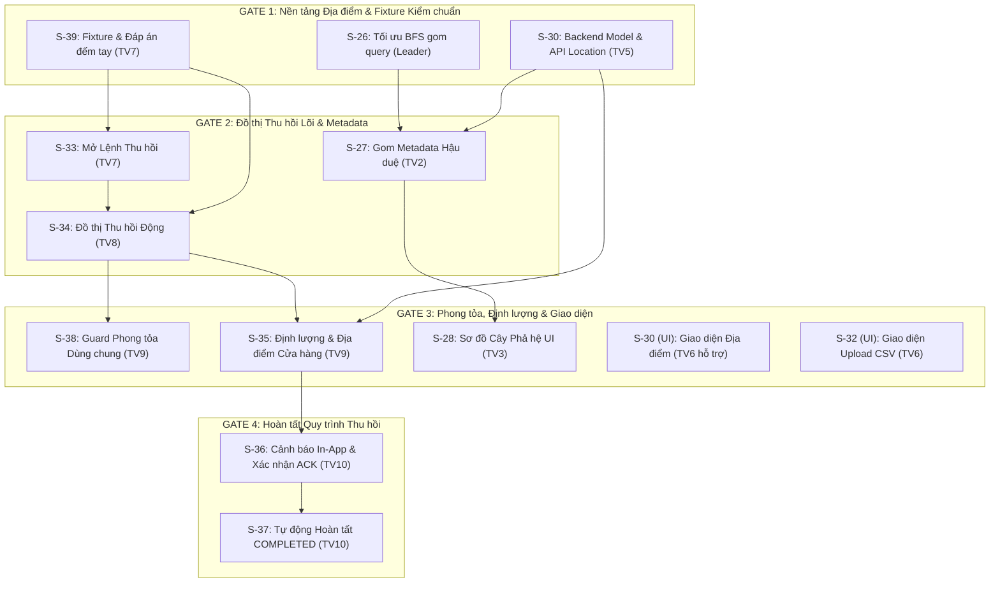

# TÀI LIỆU THIẾT KẾ KỸ THUẬT VÀ HƯỚNG DẪN TRIỂN KHAI SPRINT 3 (WAVE 0B)
**Dự án:** AgriTrace — Hệ thống Quản trị & Truy xuất Nguồn gốc Chuỗi Cung ứng Nông sản  
**Repository:** [hoangducviet04012006-ux/TTCS-K18C4-N5](https://github.com/hoangducviet04012006-ux/TTCS-K18C4-N5)  
**Quy mô:** 10 Thành viên | 14 User Stories (S-26 đến S-39) | Tổng 40 Story Points (SP)  
**Mục tiêu:** Thiết lập nền tảng kỹ thuật và quy trình chuẩn hóa để 10 thành viên tự lập trình độc lập, hạn chế tối đa Git conflict và xung đột logic, bảo toàn tuyệt đối phiên bản Sprint 2.  

---

## 1. BỐN QUYẾT ĐỊNH NGHIỆP VỤ ĐÃ ĐƯỢC PHÊ DUYỆT CHÍNH THỨC

1. **S-33 (Chính sách mở lệnh thu hồi):** Trong phạm vi Sprint 3, mỗi lô gốc chỉ được tạo tối đa **một lệnh thu hồi**. Đây là giới hạn nghiệp vụ có chủ đích của Sprint 3 nhằm bảo đảm an toàn dữ liệu và tính bất biến của chuỗi bằng chứng, không mặc định áp dụng vĩnh viễn cho các Sprint sau.
2. **S-34 (Phạm vi thu hồi của lô gộp chéo nguồn):** Khi một nguồn nông sản bị nhiễm sự cố hoặc vi phạm, **toàn bộ lô gộp có chứa nguồn đó và tất cả các thế hệ hậu duệ liên quan đều thuộc diện thu hồi 100%**. Không áp dụng bất kỳ ngưỡng tỷ lệ phần trăm pha trộn nào (theo nguyên tắc NFR: *"Thà thừa còn hơn bỏ sót"*). Bắt buộc phải kiểm thử đầy đủ các kịch bản tách lô, gộp lô và đồ thị hội tụ/hình thoi nhiều đường.
3. **Database (Bảo vệ cơ sở dữ liệu gốc):** Giữ nguyên vẹn và bảo vệ tuyệt đối file `backend/ttcs.db` cũng như dữ liệu demo Sprint 2. Mọi hoạt động phát triển, chạy migration thử nghiệm và chạy automated test phải sử dụng cơ sở dữ liệu SQLite riêng biệt (`tmp_path` hoặc file tạm độc lập). **Không gỡ bỏ cơ chế bảo vệ `is_protected_engine`**.
4. **S-36 (Phương thức thông báo thu hồi):** Chỉ triển khai cơ chế thông báo và cảnh báo thu hồi trực tiếp trong giao diện ứng dụng (In-App Notification qua endpoint `GET /recalls/my-alerts`). **Chưa tích hợp SMTP/email** ra bên ngoài trong Sprint 3 (email thông báo thuộc phạm vi Story S-59 ở Sprint 7).

---

## 2. NGUYÊN TẮC LÀM VIỆC VÀ ĐIỀU PHỐI ĐỘI NGŨ 10 THÀNH VIÊN

1. **10 Thành viên tự lập trình:** Mỗi thành viên tự chủ động lập trình trên nhánh feature của story được phân công. Antigravity chỉ đóng vai trò phân tích, hỗ trợ tài liệu, review, kiểm thử và tích hợp. Trưởng nhóm trực tiếp kiểm soát và phê duyệt việc merge Pull Request (PR) vào `develop`.
2. **Quy định về Story Points và PR:** Một User Story có thể được chia thành nhiều PR nếu có yêu cầu kỹ thuật (ví dụ: tách PR backend và PR frontend), nhưng **tuyệt đối không được tính trùng Story Points**. Tổng số điểm nghiệm thu của toàn bộ Sprint 3 luôn giữ nguyên là 40 SP.
3. **Quy tắc phong tỏa (Quarantine Lifecycle):** Lô hàng nằm trong lệnh thu hồi ở trạng thái `OPEN` hoặc `COMPLETED` đều bị phong tỏa các thao tác vật lý (bàn giao, tách, gộp, tiêu thụ, chuyển cửa hàng). **Lệnh Recall chuyển sang `COMPLETED` không tự động bỏ phong tỏa**. Việc giải phóng hoặc dỡ bỏ phong tỏa chỉ được thực hiện theo quy tắc nghiệp vụ riêng khi có chỉ đạo thanh tra được phê duyệt.
4. **Chống tạo trùng lặp bảng Recall:** Các model ORM (`Recall`, `RecallAcknowledgment`, `IdempotencyRecord`) **đã tồn tại sẵn** trong mã nguồn tại `backend/app/recall_models.py`. Thành viên không được tạo thêm các class model hay bảng trùng lặp.
5. **Quy tắc Git cho thành viên mới:** Khuyến khích và ưu tiên việc **merge `origin/develop` vào nhánh feature** khi cần cập nhật code mới nhất, thay vì bắt buộc dùng rebase phức tạp. Tuyệt đối không `git push --force` lên `main` hoặc `develop`.
6. **Vai trò người điều phối file dùng chung:** Người điều phối các file lõi (như `models.py`, `batches.py`, `index.html`) có trách nhiệm rà soát, tư vấn và hỗ trợ tích hợp; **không mặc định làm thay hay viết hộ phần việc của thành viên**.
7. **Bản chất của File Ownership Matrix:** Ma trận phân quyền tệp là **quy tắc phối hợp và giao tiếp nội bộ**, không phải là cơ chế khóa file tự động bằng công cụ. Thành viên cần chủ động trao đổi với người điều phối trước khi mở PR có chỉnh sửa file dùng chung.
8. **Quy ước trạng thái contract:** Trong tài liệu này:
   - Các API, Model và trường dữ liệu ghi nhãn **[ĐÃ TỒN TẠI]** là những thành phần đã được kiểm chứng trực tiếp từ mã nguồn thực tế.
   - Các mục ghi nhãn **[ĐỀ XUẤT MỚI]** hoặc **[CẦN SỬA]** là phần cần viết mới hoặc tối ưu hóa trong Sprint 3.

---

## 3. PHÂN CÔNG 10 THÀNH VIÊN VÀ ĐỐI CHIẾU 40 STORY POINTS

| Thành viên | Story được giao | Story Points | Nội dung công việc chính | Ranh giới hỗ trợ (Không cộng dồn SP) |
| :--- | :---: | :---: | :--- | :--- |
| **Leader** | **S-26** | **5 SP** | Tối ưu thuật toán lặp BFS, gom truy vấn `in_`, cycle detection, độ trễ $< 2$s / 1000 node | Điều phối chung, review toàn bộ PR, duyệt merge |
| **Thành viên 2** | **S-27** | **3 SP** | Gom metadata hậu duệ (tổ chức, địa điểm S-30, tồn kho) trong 1 query bulk fetch | Phối hợp với Leader về cấu trúc node BFS |
| **Thành viên 3** | **S-28** | **3 SP** | Sơ đồ phả hệ cây tương tác collapsible 3 vùng, cuộn ngang mobile (`lineage_tree.js`) | Độc lập ở frontend, đọc JSON từ API S-26/S-27 |
| **Thành viên 4** | **S-29 + S-31** | **4 SP** *(2 + 2)* | Nghiệp vụ tiêu thụ CONSUMED + Middleware AuditLog tự động ghi failed login | Phụ trách tính bất biến dữ liệu và nhật ký vận hành |
| **Thành viên 5** | **S-30** | **3 SP** | Model `Location`, migration bảng, CRUD địa điểm, chuyển lô nội bộ | Bàn giao API Location cho TV2 và TV6 |
| **Thành viên 6** | **S-32** | **2 SP** | Service nhập danh mục CSV nguyên tử (báo lỗi dòng/cột) và UI upload CSV | **Hỗ trợ UI S-30** (dựng form khai báo địa điểm thuộc 3 SP S-30) |
| **Thành viên 7** | **S-39 + S-33** | **5 SP** *(2 + 3)* | Fixture kiểm chuẩn 4 tầng có đáp án đếm tay + Mở lệnh thu hồi, băm RECALL_INIT | Cung cấp file kiểm chuẩn độc lập cho TV8 |
| **Thành viên 8** | **S-34** | **5 SP** | Duyệt đồ thị thu hồi động từ root, phát hiện lô gộp chéo nguồn, không cache tĩnh | Đối chiếu kết quả với đáp án đếm tay của TV7 |
| **Thành viên 9** | **S-35 + S-38** | **5 SP** *(3 + 2)* | Định lượng tồn kho vs tiêu thụ tích hợp địa chỉ S-30 + Guard phong tỏa 4 thao tác | Tích hợp hàm guard vào `batches.py` và `handovers.py` |
| **Thành viên 10** | **S-36 + S-37** | **5 SP** *(3 + 2)* | Cảnh báo In-App `my-alerts`, xác nhận ACK + State machine tự động COMPLETED | Hoàn thiện toàn bộ giao diện điều hành Recall trên frontend |
| **TỔNG CỘNG** | **14 Stories** | **40 SP** | *Cân bằng từ 2 đến 5 SP / người, phù hợp chuyên môn từng vị trí* | *Phần hỗ trợ UI S-30 tính trọn trong 3 SP của S-30* |

---

## 4. API CONTRACT MATRIX CHI TIẾT (S-26 ĐẾN S-39)

### 4.1. Nhóm Phả hệ & Truy xuất (S-26, S-27, S-28, S-29)

#### S-26: Truy xuôi BFS hậu duệ đa tầng [CẦN SỬA / TỐI ƯU HÓA]
- **Endpoint:** `GET /batches/{id}/trace-forward`
- **HTTP Method:** `GET`
- **Request:** Path parameter `id: int` (ID lô nông sản gốc), Query parameter `use_cache: bool = True`, `max_nodes: int = 1000`.
- **Response Schema:** [ĐÃ TỒN TẠI] `TraceForwardResponse` (gồm `target_batch`, `descendants_by_level: dict[int, list[TraceForwardNode]]`, `terminal_batches`, `total_descendants`).
- **RBAC:** Mọi vai trò đã xác thực xem được lô thuộc tổ chức mình; `inspector` và `system_admin` xem toàn bộ liên tổ chức.
- **Validation & Transaction:** Kiểm tra tồn tại lô (404). Phát hiện chu trình (Cycle detection) ném HTTP 400.
- **Nội dung cần sửa:** Trong `backend/app/services/traceability.py`, thay thế vòng lặp gọi `db.get(Batch, child_id)` bằng kỹ thuật gom 1 truy vấn `select(Batch).where(Batch.id.in_(child_ids))` để loại bỏ hoàn toàn lỗi N+1 query. Đảm bảo duyệt 1000 node dưới 2 giây.

#### S-27: Metadata Hậu duệ (Tổ chức, Địa điểm, Tồn kho) [CẦN SỬA / KẾT NỐI]
- **Endpoint:** Nằm trong payload phản hồi của `GET /batches/{id}/trace-forward`.
- **Response Node:** Mỗi node hậu duệ chứa: `batch_id`, `code`, `current_org_id`, `current_org_name`, `location`, `remaining_quantity`, `status`, `is_consumed`.
- **RBAC:** Áp dụng cơ chế Data Masking: nếu node thuộc tổ chức khác mà người dùng không có quyền xem chi tiết $\rightarrow$ ẩn vị trí (`location = "[Bảo mật]"`), gán `is_masked = true`.
- **Nội dung cần sửa:** Khi lô đã được chuyển về cửa hàng (S-30 có `location_id`), trường `location` phải lấy từ địa chỉ cửa hàng phân phối (`Location.address`), nếu chưa gán cửa hàng mới fallback về `Plot.location`. Gom toàn bộ metadata trong 1 câu truy vấn duy nhất.

#### S-28: Sơ đồ Cây Phả hệ Tương tác [ĐỀ XUẤT MỚI 100% Ở FRONTEND]
- **Tệp triển khai:** `frontend/js/lineage_tree.js` (Component độc lập).
- **Giao diện:** Tích hợp trong Tab "Phả hệ" của Modal Chi tiết Lô.
- **Quy tắc hiển thị:**
  - Bố cục 3 vùng: Cột trái (Tổ tiên / Lô cha), Cột giữa (Lô trọng tâm hiện tại), Cột phải (Hậu duệ phân tầng F1, F2,...).
  - Tương tác: Nhấp vào node để Thu gọn / Mở rộng (Collapse / Expand) các nhánh sâu.
  - Nhấp vào mã lô $\rightarrow$ mở modal chi tiết của lô đó.
  - Hỗ trợ cuộn ngang mượt mà (`overflow-x: auto`) trên màn hình điện thoại di động (responsive).

#### S-29: Tiêu thụ Nông sản (CONSUMED) [ĐÃ TỒN TẠI]
- **Endpoint:** `POST /batches/{id}/consume`
- **HTTP Method:** `POST`
- **Request Body:** `{ "notes": "string (tùy chọn)" }`
- **Response Schema:** [ĐÃ TỒN TẠI] `BatchConsumeResponse` (thông tin lô sau cập nhật và sự kiện `EVENT_CONSUMED`).
- **RBAC:** Chỉ `distributor` hoặc `org_admin` thuộc tổ chức đang nắm giữ lô.
- **Quy tắc Giao dịch:** Chuyển `remaining_quantity = 0`, `status = 'CONSUMED'`. Ghi sự kiện append-only `EVENT_CONSUMED` vào chuỗi băm. Khóa vĩnh viễn: cấm mọi thao tác bàn giao, tách, gộp, sửa đổi.

---

### 4.2. Nhóm Quản trị Địa điểm & Nhập CSV (S-30, S-32)

#### S-30: Quản lý Cửa hàng & Chuyển lô Nội bộ [ĐỀ XUẤT MỚI 100%]
- **Endpoints:**
  - `POST /organizations/locations`: Khai báo địa điểm cửa hàng/kho mới.
    - Body: `{ "name": str, "address": str }`
    - Response: HTTP 201 `{ "id": int, "organization_id": int, "name": str, "address": str, "created_at": str }`
  - `GET /organizations/locations`: Danh sách địa điểm thuộc tổ chức của tài khoản hiện tại.
  - `POST /batches/{id}/transfer-location`: Chuyển lô nội bộ sang cửa hàng.
    - Body: `{ "location_id": int }`
    - Response: HTTP 200 thông tin lô sau cập nhật.
  - Mở rộng `POST /batches/{id}/split`: Cho phép truyền `location_id` cho từng lô con được tạo ra.
- **RBAC:** Chỉ thành viên thuộc tổ chức sở hữu địa điểm. Chuyển lô nội bộ **không cần xác nhận hai phía** (không tạo Handover).
- **Quy tắc Giao dịch:** Kiểm tra `location_id` thuộc đúng `organization_id` của lô. Ghi nhận sự kiện `INTERNAL_TRANSFER` vào chuỗi băm.

#### S-32: Nhập Danh mục Sản phẩm & Thửa đất từ CSV [ĐỀ XUẤT MỚI 100%]
- **Endpoint:** `POST /catalogs/import-csv`
- **HTTP Method:** `POST`
- **Request Body:** `multipart/form-data` gồm file `.csv` và trường `entity_type: 'product' | 'plot'`.
- **Response Schema:**
  - Thành công (HTTP 200): `{ "message": str, "success_count": int }`
  - Thất bại (HTTP 422): Chi tiết lỗi theo cấu trúc:
    ```json
    {
      "detail": "Tệp CSV chứa dữ liệu không hợp lệ. Toàn bộ giao dịch đã được hoàn tác.",
      "errors": [
        { "row": 12, "column": "unit", "value": "bao", "message": "Đơn vị tính không hợp lệ, chỉ chấp nhận kg, tấn, thùng." }
      ]
    }
    ```
- **RBAC:** Chỉ `system_admin` hoặc `org_admin`. Giới hạn dung lượng tệp $\le 2$MB.
- **Quy tắc Giao dịch:** **Nguyên tử tuyệt đối (Atomic Transaction)**: Xử lý toàn bộ các dòng trong 1 transaction. Nếu có bất kỳ dòng nào sai định dạng $\rightarrow$ Rollback toàn bộ, không có bản ghi nào được tạo trong database.

---

### 4.3. Nhóm Nhật ký Vận hành (S-31)

#### S-31: Middleware Nhật ký Thao tác Tự động [CẦN SỬA / BỔ SUNG]
- **Cơ chế:** Triển khai bằng FastAPI HTTP Middleware tại `backend/app/middlewares/audit_middleware.py`.
- **Dữ liệu ghi nhận:** Bổ sung vào bảng `audit_logs` các thông tin: người thực hiện (`user_id`), tổ chức (`organization_id`), thời điểm (`created_at`), địa chỉ IP client (`ip_address`), loại hành động, mã đối tượng tác động, và nguyên nhân lỗi (`reason`).
- **Ghi nhận Failed Login:** Bắt các trường hợp đăng nhập thất bại từ `POST /auth/login` (sai mật khẩu, tài khoản bị khóa 15 phút) để ghi nhận lý do cụ thể vào cột `reason`.
- **RBAC & NFR:** Log chỉ-thêm (append-only); chỉ `system_admin`/admin mới có quyền xem qua API `GET /audit-logs`. Tuyệt đối không ghi nội dung mật khẩu hay token xác thực vào log.

---

### 4.4. Nhóm Quản lý Thu hồi Sản phẩm (S-33 đến S-39)

#### S-39: Bộ Dữ liệu Mẫu & File Kiểm chuẩn Độc lập [CẦN CHUẨN HÓA]
- **Tệp đáp án đếm tay độc lập:** `tests/fixtures/recall_s39_ground_truth.json`.
- **Kịch bản:** Đồ thị 4 tầng, 3 tổ chức (`HTX Đồng Tháp`, `Chế biến Sông Tiền`, `Phân phối Bách Hóa Xanh`) gồm 7 lô nông sản, có ít nhất 1 lô gộp chéo nguồn và 1 lô đã tiêu thụ CONSUMED. File đáp án do 2 thành viên đếm tay độc lập lập ra trước khi nghiệm thu code thuật toán.

#### S-33: Đánh dấu Sự cố & Mở Lệnh Thu hồi [CHUẨN HÓA THEO QUYẾT ĐỊNH 1]
- **Endpoint:** `POST /recalls`
- **Request Body:** `{ "root_batch_id": int, "reason": str }` kèm Header bắt buộc `Idempotency-Key: str`.
- **Response Schema:** HTTP 201 `RecallCreateResponse` (gồm `id`, `recall_code`, `root_batch_id`, `status: 'OPEN'`, `affected_batches`).
- **RBAC:** Chỉ `inspector` hoặc `org_admin` đang nắm giữ lô gốc. Các vai trò khác $\rightarrow$ HTTP 403.
- **Validation & Quyết định 1:** 
  - Lý do bắt buộc $\ge 20$ ký tự.
  - **Giới hạn Sprint 3:** Mỗi lô gốc chỉ được tạo tối đa 1 lệnh thu hồi (`uq_recall_root_lifetime`). Lô đã có lệnh thu hồi (bất kể `OPEN` hay `COMPLETED`) $\rightarrow$ trả về HTTP 409 Conflict kèm mã lệnh đang có.
  - Ghi sự kiện append-only `RECALL_INIT` vào chuỗi băm của lô gốc.

#### S-34: Liệt kê Hậu duệ Đồ thị Thu hồi Động [CHUẨN HÓA THEO QUYẾT ĐỊNH 2]
- **Endpoint:** `GET /recalls/{id}`
- **Response Schema:** Chi tiết Recall kèm mảng `affected_batches` được tính toán động từ đồ thị.
- **RBAC:** `inspector` xem toàn bộ; người dùng tổ chức chỉ thấy các lô thuộc quyền quản lý của tổ chức mình.
- **Quy tắc Thuật toán & Quyết định 2:**
  - Danh sách tính lại trực tiếp từ đồ thị mỗi lần xem, **không lưu cứng danh sách lúc mở lệnh** và **không dùng cache tĩnh**.
  - **Không áp dụng ngưỡng pha trộn:** Khi một nguồn bị thu hồi, toàn bộ lô gộp chứa nguồn đó và các thế hệ sau đều bị thu hồi 100%. Lô gộp được gắn cờ `is_merged_cross_origin: true`.
  - Thuật toán Kahn phát hiện chu trình phả hệ bất thường.

#### S-35: Phân bổ Địa điểm, Tồn kho và Hàng Tiêu thụ [CẦN SỬA / KẾT NỐI]
- **Endpoint:** Nằm trong payload của `GET /recalls/{id}`.
- **Response Data:** Bổ sung `metrics_by_unit`: `reclaimable_quantity` (khối lượng tồn còn thu hồi được) và `known_consumed_quantity` (khối lượng đã bán ra thị trường có chứng cứ).
- **Kết nối Địa điểm S-30:** Hiển thị chính xác địa chỉ cửa hàng bán lẻ nơi lô đang nằm (từ `Location.address`), không hiển thị địa chỉ thửa đất nông trại ban đầu nếu lô đã được chia về cửa hàng. Nhóm dữ liệu theo tổ chức để bảo vệ bí mật kinh doanh.

#### S-38: Dịch vụ Phong tỏa Dùng chung [CẦN SỬA / BỔ SUNG]
- **Kiến trúc:** Triển khai hàm guard tập trung `check_batch_quarantine_guard(db, batch_id)` trong `backend/app/services/recall.py`.
- **Quy tắc Phong tỏa:** Khi lô nằm trong một lệnh thu hồi (ở trạng thái `OPEN` hoặc `COMPLETED`), mọi thao tác vật lý sau đều bị **chặn ngay lập tức với HTTP 409 Conflict** kèm mã lệnh thu hồi:
  1. Bàn giao lô (`POST /handovers`)
  2. Tiếp nhận bàn giao (`POST /handovers/{id}/accept`)
  3. Tách lô (`POST /batches/{id}/split`)
  4. Gộp lô (`POST /batches/{id}/merge`)
  5. Tiêu thụ lô (`POST /batches/{id}/consume`)
  6. Chuyển địa điểm nội bộ (`POST /batches/{id}/transfer-location`)

#### S-36: Cảnh báo In-App & Xác nhận Xử lý (ACK) [CHUẨN HÓA THEO QUYẾT ĐỊNH 4]
- **Endpoints:**
  - `GET /recalls/my-alerts`: Trả về danh sách các lệnh thu hồi đang chạm tới lô của tổ chức hiện tại.
  - `POST /recalls/{id}/acknowledge`: Tổ chức gửi xác nhận đã gom và xử lý hàng.
    - Body: `{ "notes": str }` kèm `Idempotency-Key`.
    - Response: HTTP 200 cập nhật bản ghi xác nhận.
- **RBAC & Quyết định 4:** Chỉ `org_admin` của tổ chức liên quan mới được gửi ACK. **Chỉ hiển thị cảnh báo In-App khi đăng nhập; chưa dùng email SMTP**.
- **Tính Bất biến:** Bản ghi xác nhận và sự kiện `RECALL_ACKNOWLEDGED` là append-only, ghi nhận thời điểm và người xác nhận, không thể sửa đổi hay xóa bỏ.

#### S-37: Theo dõi Tiến độ & Tự động Hoàn tất COMPLETED [ĐÃ TỒN TẠI LOGIC LÕI]
- **Cơ chế Máy trạng thái:** Nằm trong transaction xử lý của API `POST /recalls/{id}/acknowledge`.
- **Theo dõi Tiến độ:** Trả về tỷ lệ `progress: "x/y"` (số tổ chức đã xác nhận / tổng số tổ chức liên quan).
- **Tự động Hoàn tất:** Khi tổ chức liên quan cuối cùng gửi xác nhận thành công ($x = y$) $\rightarrow$ Hệ thống tự động chuyển `Recall.status = 'COMPLETED'`, ghi nhận `completed_at` và ghi sự kiện `RECALL_COMPLETED`.
- **Bảo lưu Hồ sơ:** Lệnh `COMPLETED` được lưu trữ vĩnh viễn trong hệ thống, tiếp tục duy trì trạng thái phong tỏa đối với các lô sự cố để phục vụ tra cứu thanh tra.

---

## 5. DATABASE CONTRACT VÀ KẾ HOẠCH MIGRATION THỬ NGHIỆM

### 5.1. Rà soát Schema Hiện tại
- Các bảng hiện có trên database Sprint 2: `organizations`, `users`, `farms`, `plots`, `products`, `batches`, `batch_events`, `batch_relations`, `handovers`, `audit_logs`.
- Các bảng Recall (`recalls`, `recall_acknowledgments`, `idempotency_records`): **Đã có sẵn khai báo ORM trong `backend/app/recall_models.py`**, không được tạo lại.

### 5.2. Ba Migration Mới Cần Thiết Cho Sprint 3:
1. **Tạo bảng `locations` (S-30):** Lưu địa điểm cửa hàng/kho trực thuộc tổ chức.
2. **Thêm cột `batches.location_id` (S-30):** Khóa ngoại nullable trỏ về `locations.id`.
3. **Mở rộng bảng `audit_logs` (S-31):** Thêm các cột `ip_address VARCHAR(50)`, `organization_id INTEGER`, `reason TEXT`.

### 5.3. Kế hoạch Thực thi Migration Thử nghiệm An toàn:
- **Tuyệt đối không chạy migration trên `backend/ttcs.db`**.
- Mọi kiểm thử migration được thực hiện thông qua script thử nghiệm độc lập trên SQLite file tạm thời (hoặc pytest `tmp_path`).
- Script kiểm tra đảm bảo:
  - Giữ nguyên 100% dữ liệu lịch sử và chuỗi băm của Sprint 2.
  - Hỗ trợ rollback an toàn nếu quá trình thực thi gặp lỗi.
  - Toàn bộ 293 test hiện tại tiếp tục PASS mà không gặp xung đột schema.

---

## 6. FILE OWNERSHIP MATRIX (MA TRẬN QUYỀN SỞ HỮU TỆP)

*Lưu ý: Ma trận dưới đây là quy tắc phối hợp và giao tiếp nội bộ, không phải cơ chế khóa tệp tự động.*

| Mã Story | Thành viên phụ trách | File được phép chỉnh sửa | File dùng chung cần Leader duyệt | File mới dự kiến | Reviewer chỉ định | Phụ thuộc bắt buộc | Mức độ nguy cơ Conflict |
| :---: | :---: | :--- | :--- | :--- | :---: | :---: | :---: |
| **S-26** | **Leader** | `backend/app/services/traceability.py` | `backend/app/routers/batches.py` | `backend/tests/test_s26_trace_forward_perf.py` | TV2 | S-21 | 🟡 Trung bình |
| **S-27** | **TV2** | `backend/app/services/traceability.py` | `backend/app/schemas.py` | `backend/tests/test_s27_descendant_metadata.py` | Leader | S-26, S-30 | 🟡 Trung bình |
| **S-28** | **TV3** | `frontend/css/style.css` | `frontend/index.html` | `frontend/js/lineage_tree.js` | Leader | S-26, S-27 | 🟢 Thấp |
| **S-29** | **TV4** | `backend/app/routers/batches.py` | `backend/app/schemas.py` | `backend/tests/test_s29_consumed_regression.py` | TV9, Leader | S-25 | 🟢 Thấp |
| **S-30** | **TV5** | Không có (ưu tiên tạo mới) | `backend/app/models.py`, `backend/app/database.py` | `backend/app/routers/locations.py`, `backend/app/schemas_locations.py`, `backend/tests/test_locations.py` | TV6, Leader | S-25 | 🔴 Cao (DB schema) |
| **S-31** | **TV4** | `backend/app/routers/auth.py` | `backend/app/models.py`, `backend/app/database.py` | `backend/app/middlewares/audit_middleware.py`, `backend/tests/test_audit_middleware.py` | Leader | S-25 | 🔴 Cao (DB schema) |
| **S-32** | **TV6** | `frontend/css/style.css` | `backend/app/main.py`, `frontend/index.html` | `backend/app/routers/imports.py`, `backend/app/services/csv_import.py`, `frontend/js/csv_import.js`, `backend/tests/test_csv_import.py` | TV5, Leader | S-25 | 🟡 Trung bình |
| **S-33** | **TV7** | `backend/app/services/recall.py` | `backend/app/routers/recalls.py`, `backend/app/recall_models.py` | `backend/tests/test_s33_recall_init.py` | TV8, Leader | S-27, S-39 | 🔴 Cao (Shared recall) |
| **S-34** | **TV8** | `backend/app/services/recall_graph.py` | `backend/app/routers/recalls.py` | `backend/tests/test_s34_dynamic_graph.py` | TV7, Leader | S-33, S-39 | 🔴 Cao (Graph engine) |
| **S-35** | **TV9** | `backend/app/services/recall.py` | `backend/app/routers/recalls.py` | `backend/tests/test_s35_recall_metrics.py` | TV10, Leader | S-34, S-30 | 🔴 Cao (Shared recall) |
| **S-36** | **TV10** | `frontend/js/recall.js` | `backend/app/routers/recalls.py`, `backend/app/services/recall.py` | `backend/tests/test_s36_alerts_and_ack.py` | TV9, Leader | S-35 | 🔴 Cao (Shared recall) |
| **S-37** | **TV10** | `frontend/js/recall.js` | `backend/app/routers/recalls.py`, `backend/app/services/recall.py` | `backend/tests/test_s37_auto_completion.py` | Leader | S-36 | 🟡 Trung bình |
| **S-38** | **TV9** | `backend/app/services/recall.py` | `backend/app/routers/batches.py`, `backend/app/routers/handovers.py` | `backend/tests/test_s38_quarantine_guard.py` | TV8, Leader | S-34 | 🔴 Cao (Guard batches) |
| **S-39** | **TV7** | `backend/scripts/seed_recall_s39.py` | Không có | `tests/fixtures/recall_s39_ground_truth.json`, `backend/tests/test_s39_fixture_oracle.py` | TV8, Leader | S-22, S-29 | 🟢 Thấp |

---

## 7. DEPENDENCY GRAPH VÀ THỨ TỰ MERGE PULL REQUEST

### 7.1. Đồ thị Phụ thuộc Kỹ thuật



### 7.2. Kế hoạch Merge Pull Request theo 5 Wave:
- **Wave 0:** Merge PR 0 tài liệu (`docs/sprint3-wave0-contracts`).
- **Wave 1:**
  - PR 1: `feat/S39-recall-ground-truth` (TV7)
  - PR 2: `feat/S31-audit-middleware` (TV4)
  - PR 3: `feat/S30-locations-backend` (TV5)
  - PR 4: `feat/S32-csv-import-backend` (TV6)
  - PR 5: `feat/S26-trace-bfs-optimize` (Leader)
- **Wave 2:**
  - PR 6: `feat/S27-descendant-metadata` (TV2)
  - PR 7: `feat/S29-consumed-finalize` (TV4)
  - PR 8: `feat/S33-recall-initiation` (TV7)
  - PR 9: `feat/S34-recall-dynamic-graph` (TV8)
- **Wave 3:**
  - PR 10: `feat/S38-recall-quarantine-guard` (TV9)
  - PR 11: `feat/S35-recall-locations-metrics` (TV9)
  - PR 12: `feat/S28-lineage-tree-ui` (TV3)
  - PR 13: `feat/S30-locations-ui` (TV6 hỗ trợ)
  - PR 14: `feat/S32-csv-import-ui` (TV6)
- **Wave 4:**
  - PR 15: `feat/S36-recall-alerts-and-ack` (TV10)
  - PR 16: `feat/S37-recall-auto-completion` (TV10)
- **Wave 5:**
  - PR 17: `chore/sprint3-final-hardening-and-regression` (Nghiệm thu toàn diện toàn bộ 14 stories).

---

## 8. HƯỚNG DẪN THAO TÁC GIT DÀNH CHO THÀNH VIÊN

1. **Khởi tạo nhánh làm việc:**
   ```powershell
   git checkout develop
   git pull origin develop
   git checkout -b feat/SXX-ten-chuc-nang
   ```
2. **Đồng bộ code mới từ `develop` (Tránh conflict):**
   ```powershell
   # Khuyến khích merge trực tiếp develop vào feature branch
   git checkout feat/SXX-ten-chuc-nang
   git fetch origin
   git merge origin/develop
   ```
3. **Quy chuẩn Commit:**
   - Sử dụng cú pháp Conventional Commits: `feat(S-XX): ...`, `test(S-XX): ...`, `fix(S-XX): ...`.
   - Tuyệt đối không commit file database (`*.db`), file bí mật (`.env`), hoặc file tạm (`scratch/`).
4. **Kiểm tra chất lượng trước khi đẩy nhánh:**
   ```powershell
   backend\.venv\Scripts\python -m flake8 backend/app backend/tests
   backend\.venv\Scripts\python -m pytest backend/tests
   ```
5. **Đẩy nhánh và mở Pull Request:**
   ```powershell
   git push -u origin feat/SXX-ten-chuc-nang
   ```
   - Mở PR trỏ vào nhánh **`develop`** (không mở vào `main`).
   - Gắn Reviewer theo phân công tại Ma trận mục 6.
6. **Sau khi PR được merge:**
   ```powershell
   git checkout develop
   git pull origin develop
   git branch -d feat/SXX-ten-chuc-nang
   ```

---

## 9. ĐIỀU KIỆN SẴN SÀNG (DoR) VÀ TIÊU CHÍ HOÀN THÀNH (DoD)

### 9.1. Definition of Ready (DoR) — Bắt đầu một Story:
Một thành viên chỉ được bắt đầu code khi:
- [x] Đã có Acceptance Criteria rõ ràng.
- [x] Đã xác định người phụ trách và Reviewer.
- [x] Đã chốt API/DB Contract liên quan.
- [x] Đã xác định danh sách file được sửa và file mới.
- [x] Các dependency bắt buộc đã được merge vào `develop`.
- [x] Đã lập kế hoạch test cases tối thiểu.
- [x] Không còn quyết định nghiệp vụ bắt buộc nào chưa chốt.

### 9.2. Definition of Done (DoD) — Nghiệm thu một Story / PR:
Một PR chỉ được duyệt merge khi:
- [x] Thỏa mãn 100% Acceptance Criteria của Story.
- [x] Có Unit & Integration Tests bao phủ các nhánh nghiệp vụ mới.
- [x] **Zero Regression:** Toàn bộ 293 bài test hiện có tiếp tục PASS 100%.
- [x] `flake8 backend/app backend/tests` đạt 0 lỗi (tuân thủ giới hạn dòng và độ phức tạp hàm).
- [x] `node --check frontend/js/*.js` không có lỗi cú pháp.
- [x] Không làm thay đổi hay ghi đè dữ liệu trên database gốc `backend/ttcs.db`.
- [x] Được tối thiểu 1 Reviewer chỉ định chấp thuận và Trưởng nhóm phê duyệt.

---

## 10. DANH SÁCH RỦI RO KỸ THUẬT VÀ PHƯƠNG ÁN XỬ LÝ

| Mã rủi ro | Mô tả rủi ro | Tác động | Xác suất | Giải pháp phòng ngừa & Xử lý |
| :---: | :--- | :---: | :---: | :--- |
| **R-01** | Nhiều thành viên cùng sửa `app.js` và `index.html` gây conflict nặng | 🔴 Cao | 🔴 Rất cao | **Cấm viết vào `app.js`**. Mỗi tính năng tạo file `.js` module độc lập. `index.html` chỉ sửa theo hướng dẫn điều phối của Leader. |
| **R-02** | Xung đột logic trong `recall.py` do nhiều story cùng tác động | 🔴 Cao | 🟡 Trung bình | Tuân thủ nghiêm ngặt thứ tự merge theo Wave (PR 8 $\rightarrow$ PR 9 $\rightarrow$ PR 10 $\rightarrow$ PR 11 $\rightarrow$ PR 15 $\rightarrow$ PR 16). |
| **R-03** | Lỗi N+1 query trên BFS làm chậm hệ thống khi đồ thị $\ge 1000$ lô | 🟡 Trung bình | 🟡 Trung bình | Bắt buộc Leader tối ưu hóa truy vấn `in_` gom cụm trong S-26 trước khi TV2 làm S-27. |
| **R-04** | Vô tình làm hỏng database gốc `backend/ttcs.db` khi chạy test | 🔴 Nghiêm trọng | 🟢 Thấp | Giữ nguyên `is_protected_engine()` và trigger từ chối tạo bảng. Mọi test suite dùng SQLite file tạm thời. |
| **R-05** | Vi phạm linter `flake8` làm gãy CI pipeline trên GitHub Actions | 🟡 Trung bình | 🔴 Cao | Bắt buộc thành viên chạy `flake8` local trước khi commit. CI tự động từ chối merge nếu có lỗi lint. |

---

*Tài liệu này là căn cứ kỹ thuật chính thức duy nhất để 10 thành viên phối hợp triển khai Sprint 3.*
