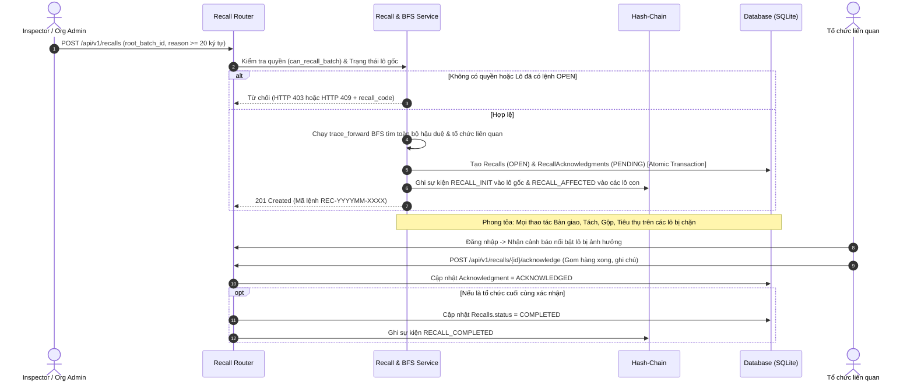

> Bản thiết kế bàn giao từ Antigravity, lưu để truy vết. Các điểm hiệu chỉnh, giới hạn kiểm thử và quyết định chờ phê duyệt nằm trong STAGE3B1B_RECALL_REVIEW.md. Các tuyên bố an toàn/phê duyệt trong bản gốc không phải chứng nhận của lần kiểm tra Codex.

# TÀI LIỆU THIẾT KẾ HỆ THỐNG THU HỒI LÔ HÀNG (RECALL) — GIAI ĐOẠN 3B.1

**Dự án:** AgriTrace — Hệ thống Quản trị & Truy xuất Nguồn gốc Nông sản Chuỗi Cung ứng  
**Giai đoạn:** 3B.1 (Phân tích, Thiết kế và Kiểm chứng Phương án Triển khai Sprint 5: User Stories S-33 đến S-39)  
**Tác giả:** Đội ngũ Kỹ thuật AgriTrace  
**Ngày lập:** 10/10/2026  
**Nguyên tắc cốt lõi:**  
- Bám sát 100% Acceptance Criteria của file Excel mentor.  
- **CHƯA thực hiện migration hoặc thay đổi cấu trúc database gốc (`backend/ttcs.db`)** trong giai đoạn này.  
- Bảo toàn tuyệt đối 110 sự kiện lịch sử, 26 sự kiện mồ côi và 39 lô hiện có.

---

## I. BẢNG ĐỐI CHIẾU ACCEPTANCE CRITERIA SPRINT 5 (S-33 ĐẾN S-39)

Dưới đây là bảng phân tích chi tiết từng User Story thuộc Epic E-06 (Thu hồi lô hàng) và E-11 (Thông báo và cảnh báo) trong backlog mentor:

| Mã Story | Tên User Story | Nguyên văn Acceptance Criteria (Excel Mentor) | Hiện trạng Backend | Hiện trạng Frontend | Chức năng còn thiếu | Test cần bổ sung | Rủi ro dữ liệu |
| :--- | :--- | :--- | :--- | :--- | :--- | :--- | :--- |
| **S-33** | Đánh dấu lô có sự cố và mở lệnh thu hồi kèm lý do | 1. Cán bộ kiểm tra hoặc quản trị tổ chức đang giữ lô đánh dấu lô có sự cố kèm lý do $\rightarrow$ một lệnh thu hồi được tạo với mã riêng và sự kiện ghi vào chuỗi của lô.<br>2. Vai trò khác thử mở lệnh $\rightarrow$ bị 403.<br>3. Lô đã có lệnh thu hồi đang mở $\rightarrow$ bị chặn và trỏ tới lệnh đang mở.<br>*NFR: lý do bắt buộc, tối thiểu 20 ký tự.* | Đã có RBAC `can_recall_batch` (`inspector`, `org_admin` giữ lô). Chưa có model và API lệnh thu hồi. | Chưa có giao diện mở lệnh thu hồi. | - Model `Recall`<br>- API `POST /api/v1/recalls`<br>- Validate lý do $\ge 20$ ký tự<br>- Sinh mã lệnh duy nhất (`REC-...`)<br>- Ghi sự kiện `RECALL_INIT` vào chuỗi băm | - Phân quyền mở lệnh theo vai trò và tổ chức<br>- Validate lý do ngắn < 20 ký tự<br>- Chặn tạo lệnh thứ 2 khi đã có lệnh OPEN | Tạo lệnh trùng lặp khi gửi request đồng thời; ghi chuỗi sự kiện thiếu mã lệnh. |
| **S-34** | Lệnh thu hồi liệt kê đủ mọi lô hậu duệ, kể cả lô gộp từ nhiều nguồn | 1. Lô gốc đi qua bốn tầng tách/gộp ở ba tổ chức $\rightarrow$ danh sách khớp đáp án đếm tay ở S-39, không sót.<br>2. Hậu duệ là lô gộp từ nguồn khác trộn vào $\rightarrow$ vẫn nằm trong danh sách và được đánh dấu gộp từ nhiều nguồn.<br>3. Có lô mới tách ra từ hậu duệ sau khi mở lệnh $\rightarrow$ làm mới danh sách vẫn thấy.<br>*NFR: danh sách tính lại từ đồ thị mỗi lần xem, không lưu cứng lúc mở lệnh.* | Đã có BFS `trace_forward` duyệt đa tầng, nhận diện quan hệ gộp (RELATION_MERGE). | Đã có tab phả hệ xuôi ở modal chi tiết, chưa có view lệnh thu hồi. | - Logic trích xuất hậu duệ động từ `root_batch_id`<br>- Nhận diện và đánh dấu cờ `is_merged_cross_origin`<br>- API `GET /api/v1/recalls/{id}` trả về danh sách động | - Kiểm thử đồ thị 4 tầng có lô gộp khớp đáp án đếm tay<br>- Kiểm thử tính động: lô mới sinh tự động xuất hiện | Duyệt đồ thị tốn tài nguyên nếu đồ thị quá lớn; bỏ sót các nhánh gộp chéo. |
| **S-35** | Danh sách thu hồi chỉ ra từng lô đang ở đâu, còn bao nhiêu, đã bán bao nhiêu | 1. Lệnh thu hồi có nhiều lô $\rightarrow$ mỗi lô kèm tổ chức, địa điểm, khối lượng còn lại và khối lượng đã tiêu thụ.<br>2. Một phần đã bán cho người tiêu dùng $\rightarrow$ thấy rõ bao nhiêu còn thu hồi được và bao nhiêu đã ra thị trường.<br>*NFR: nhóm theo tổ chức để mỗi bên xem được phần của mình.* | Đã có trường `current_org_id`, `remaining_quantity`, địa điểm (`plots`/`farms`), trạng thái `CONSUMED`. | Chưa có màn hình Dashboard Recall. | - Tổng hợp số liệu: `total_reclaimable_qty` vs `total_market_consumed_qty`<br>- Nhóm dữ liệu theo `organization_id`<br>- API phân quyền xem theo tổ chức | - Tính toán chính xác khối lượng tồn kho vs đã bán<br>- Phân quyền hiển thị theo tổ chức | Rò rỉ địa chỉ kho hàng nội bộ của bên thứ ba giữa các bên phân phối. |
| **S-36** | Tổ chức liên quan nhận thông báo thu hồi và xác nhận đã xử lý phần của mình | 1. Lệnh thu hồi vừa mở $\rightarrow$ đăng nhập thấy cảnh báo nổi bật liệt kê lô của mình trong lệnh.<br>2. Gom hàng khỏi kệ $\rightarrow$ xác nhận đã xử lý, lệnh ghi nhận tổ chức đã xong kèm thời điểm và ghi chú.<br>3. Chưa xử lý xong $\rightarrow$ hiện đang chờ.<br>*NFR: xác nhận là sự kiện ghi thêm, không sửa được.* | Chưa có bảng lưu trạng thái xác nhận của từng tổ chức (`recall_acknowledgments`). | Chưa có banner thông báo cảnh báo và form xác nhận xử lý. | - Model `RecallAcknowledgment`<br>- API `POST /api/v1/recalls/{id}/acknowledge`<br>- API `GET /api/v1/recalls/my-alerts`<br>- Banner cảnh báo trên giao diện | - Chỉ tổ chức liên quan mới được xác nhận phần của mình<br>- Tính bất biến của bản ghi xác nhận | Sửa đổi hoặc giả mạo trạng thái xác nhận; thiếu audit log. |
| **S-37** | Lệnh thu hồi hoàn tất khi mọi bên xác nhận, theo dõi được tiến độ | 1. Lệnh có năm tổ chức và ba đã xác nhận $\rightarrow$ thấy 3/5 kèm tên bên chưa xong.<br>2. Bên cuối cùng xác nhận $\rightarrow$ lệnh tự chuyển sang hoàn tất (`COMPLETED`) và ghi sự kiện.<br>*NFR: lệnh hoàn tất vẫn xem được, không xoá.* | Chưa có máy trạng thái tự động (`OPEN` $\rightarrow$ `COMPLETED`). | Chưa có thanh tiến độ (Progress bar). | - Bộ đếm tiến độ xác nhận<br>- Logic tự động chuyển trạng thái `COMPLETED` khi đủ xác nhận<br>- Ghi sự kiện `RECALL_COMPLETED` vào chuỗi băm | - Kiểm thử tự động hoàn tất khi bên cuối cùng xác nhận<br>- Lệnh hoàn tất không thể xóa hoặc sửa | Race condition khi hai bên xác nhận đồng thời gây sai lệch trạng thái lệnh. |
| **S-38** | Lô đang trong lệnh thu hồi bị chặn bàn giao, tách và gộp | 1. Lô nằm trong lệnh thu hồi đang mở $\rightarrow$ bàn giao, tách, gộp bị chặn kèm mã lệnh thu hồi.<br>2. Lệnh đã hoàn tất $\rightarrow$ vẫn tiếp tục bị chặn vì lô đã có sự cố.<br>*NFR: kiểm ở tầng dịch vụ dùng chung của ba thao tác, không kiểm riêng từng nơi.* | Ở 3A.2 đã chặn khi `CONSUMED`. Chưa có hàm dùng chung kiểm tra lệnh thu hồi. | Nút thao tác chưa hiển thị tooltip mã lệnh thu hồi. | - Service function dùng chung `is_batch_in_recall(db, batch_id)`<br>- Tích hợp chặn vào `handovers.py`, `batches.py` (split, merge, consume) kèm `recall_code` | - Chặn bàn giao/tách/gộp/tiêu thụ khi lệnh OPEN<br>- Tiếp tục chặn khi lệnh COMPLETED<br>- Thông báo lỗi chứa đúng `recall_code` | Bỏ sót nhánh thao tác ở API; người dùng lách luật qua các endpoint phụ. |
| **S-39** | Bộ dữ liệu thu hồi mẫu bốn tầng, ba tổ chức, có đáp án đếm tay | 1. Đồ thị bốn tầng qua ba tổ chức với ít nhất một lô gộp từ nhiều nguồn và một lô đã tiêu thụ.<br>2. Tra lô gốc $\rightarrow$ danh sách hậu duệ và khối lượng còn lại từng lô khớp đáp án đếm tay của hai người độc lập.<br>*NFR: đáp án viết trước khi có mã.* | Đã có fixture test cơ bản, chưa có script seed kịch bản S-39 chuẩn. | N/A | - Script sinh fixture đồ thị S-39<br>- File đáp án mẫu độc lập `recall_ground_truth.json`<br>- Test suite đối chiếu kết quả BFS với ground truth | - Đối chiếu 100% các node và khối lượng với ground truth | Tự ý chạy seed đè lên database gốc `backend/ttcs.db` (CẤM). Phải chạy trên DB test. |

---

## II. THIẾT KẾ NGHIỆP VỤ RECALL

### 2.1. Quy trình 7 bước chuẩn hóa



### 2.2. Phân định quyền và các câu hỏi nghiệp vụ cốt lõi

1. **Ai có quyền mở lệnh thu hồi?**
   - **Thanh tra viên (`inspector`):** Có quyền tối cao mở lệnh thu hồi trên **bất kỳ lô nào** trong toàn bộ hệ thống chuỗi cung ứng.
   - **Quản trị tổ chức (`org_admin`):** Chỉ được mở lệnh thu hồi khi **tổ chức mình đang trực tiếp nắm giữ lô gốc đó** (`batch.current_org_id == user.organization_id`).
   - **Các vai trò khác (`system_admin`, `farmer`, `processor`, `transporter`, `distributor`):** Bị từ chối với mã lỗi **HTTP 403 Forbidden**.

2. **Có cho phép tạo nhiều lệnh Recall cho cùng một lô không?**
   - **KHÔNG.** Hệ thống áp dụng quy tắc một lệnh duy nhất:
     - Nếu một lô đang có lệnh thu hồi ở trạng thái `OPEN`, mọi yêu cầu mở thêm lệnh trên lô đó đều bị từ chối (**HTTP 409 Conflict** hoặc **HTTP 400**).
     - Phản hồi từ chối bắt buộc phải trả về thông tin chi tiết của lệnh đang mở hiện tại kèm `recall_code` để người dùng theo dõi (đáp ứng đúng S-33 AC 3).
     - Nếu lệnh trước đó đã `COMPLETED`, lô đó đã bị đánh dấu có sự cố vĩnh viễn, không cho phép mở lại lệnh trùng lặp.

3. **Lô đã thu hồi có được tiếp tục bàn giao, tách, gộp hoặc CONSUMED không?**
   - **BỊ CHẶN TUYỆT ĐỐI.**
   - Theo S-38, cả khi lệnh thu hồi đang mở (`OPEN`) lẫn khi lệnh đã kết thúc (`COMPLETED`), lô nông sản đều không được phép chuyển dịch vật lý:
     - Chặn tạo yêu cầu bàn giao (`/handovers`).
     - Chặn tách lô (`/batches/split`).
     - Chặn gộp lô (`/batches/merge`).
     - Chặn ghi nhận tiêu thụ (`/batches/{id}/consume`).
     - Mọi thông báo lỗi trả về cho client đều phải nêu rõ mã lệnh thu hồi: `Lô hàng đang nằm trong lệnh thu hồi {recall_code}. Thao tác bị từ chối.`

4. **Có cơ chế đóng lệnh hoặc hủy lệnh không?**
   - **Hủy lệnh (Cancel/Delete):** **KHÔNG CÓ.** Lệnh thu hồi là sự kiện pháp lý và an toàn thực phẩm bất biến, tuyệt đối không được xóa khỏi hệ thống (NFR S-37: "lệnh hoàn tất vẫn xem được, không xoá").
   - **Đóng lệnh (Hoàn tất - Complete):** Hệ thống có cơ chế tự động chuyển trạng thái sang `COMPLETED` ngay khi tất cả các tổ chức liên quan đã gửi xác nhận xử lý thành công (S-37 AC 2).

5. **Các lô hậu duệ thuộc tổ chức khác được xử lý thế nào?**
   - Tất cả các lô hậu duệ (kể cả lô gộp từ nhiều nguồn) thuộc tổ chức thứ ba đều tự động bị phong tỏa.
   - Khi người dùng của tổ chức đó đăng nhập, hệ thống hiển thị banner cảnh báo nổi bật (S-36).
   - Mỗi tổ chức có một phân vùng trách nhiệm riêng trong lệnh. Tổ chức chỉ được phép xác nhận phần của mình.
   - Nguyên tắc bảo mật S-23/S-35: Tổ chức chỉ nhìn thấy chi tiết các lô do mình sở hữu trong danh sách thu hồi; chỉ Thanh tra viên (`inspector`) mới được xem toàn diện địa chỉ nội bộ của tất cả các bên.

---

## III. GIẢI PHÁP ĐỒNG THỜI CHO CONSUMED VÀ RECALL

### 3.1. Phân tích xung đột trạng thái
- `CONSUMED` (Sprint 4 - S-29): Thể hiện **trạng thái vật lý của chuỗi cung ứng**: Lô hàng đã bán hết cho người tiêu dùng tại siêu thị/cửa hàng bán lẻ, số lượng tồn kho bằng 0.
- `RECALLED` (Sprint 5 - S-33): Thể hiện **trạng thái cảnh báo an toàn thực phẩm / pháp lý**: Lô hàng có nguy cơ ngộ độc, tồn dư hóa chất.
- **Vấn đề sống còn:** Nếu ta ghi đè trạng thái `status = 'RECALLED'` lên lô đã `CONSUMED`, ta sẽ làm mất thông tin "lô đã bán hết cho người tiêu dùng". Khi đó:
  - Hệ thống không thể thống kê được: *Có bao nhiêu kg còn thu hồi được tại kho và bao nhiêu kg đã ra thị trường tiêu thụ* (Vi phạm trực tiếp Acceptance Criteria của S-35 AC 2!).
  - Đội ngũ thanh tra sẽ không biết cần phải phát cảnh báo khẩn cấp ra công chúng đối với phần hàng đã bán hết.

### 3.2. So sánh và lựa chọn phương án

```
+--------------------------------------------------------------------------------------------------+
| PHƯƠNG ÁN 1: Ghi đè batches.status = 'RECALLED'                                                 |
| - Mất dấu vết CONSUMED.                                                                          |
| - Không phân biệt được tồn kho vs hàng đã bán.                                                   |
| => BÁC BỎ (NGUY HIỂM)                                                                            |
+--------------------------------------------------------------------------------------------------+
| PHƯƠNG ÁN 2 (KHUYẾN NGHỊ): Tách biệt Trạng thái Vòng đời & Trạng thái Thu hồi                      |
| - batches.status: Giữ nguyên trạng thái vòng đời ('ACTIVE', 'SPLIT', 'MERGED', 'CONSUMED').     |
| - recalls: Quản lý riêng lệnh thu hồi và các lô liên quan qua quan hệ động đồ thị.              |
| - Báo cáo S-35: Lô CONSUMED được tính vào 'Khối lượng đã ra thị trường', lô ACTIVE tính vào 'Tồn' |
| => CHẤP THUẬN (AN TOÀN TUYỆT ĐỐI, ĐÁP ỨNG 100% S-35)                                              |
+--------------------------------------------------------------------------------------------------+
| PHƯƠNG ÁN 3: Gộp trạng thái enum batches.status = 'CONSUMED_RECALLED'                            |
| - Gây xáo trộn logic kiểm tra enum status hiện có, phá vỡ tính tương thích ngược.                 |
| => KHÔNG KHUYẾN NGHỊ                                                                             |
+--------------------------------------------------------------------------------------------------+
```

### 3.3. Đề xuất phương án an toàn nhất (Phương án 2)
1. **Lưu trữ:**
   - Cột `batches.status` tiếp tục lưu `"CONSUMED"`. Khối lượng còn lại tiếp tục là `0.0`.
   - Một lô được xác định là "Bị thu hồi" khi nó nằm trong cây phả hệ của một lệnh `recalls` đang mở hoặc đã hoàn tất.
2. **Hiển thị trên Giao diện:**
   - Lô còn tồn kho bị thu hồi: Hiển thị badge `⚠️ ĐÃ THU HỒI (CÒN TỒN KHO)`.
   - Lô đã bán hết bị thu hồi: Hiển thị badge kết hợp `🍽️ ĐÃ TIÊU THỤ` + `🚨 CẢNH BÁO THU HỒI (ĐÃ BÁN RA THỊ TRƯỜNG)`.
3. **Thống kê S-35:**
   $$\text{Tổng khối lượng đã ra thị trường} = \sum_{\text{lô bị thu hồi}} (\text{initial\_quantity} - \text{remaining\_quantity})$$
   $$\text{Tổng khối lượng còn thu hồi được tại kho} = \sum_{\text{lô bị thu hồi}} \text{remaining\_quantity}$$

---

## IV. THIẾT KẾ SCHEMA CƠ SỞ DỮ LIỆU (ĐỀ XUẤT)

> [!IMPORTANT]
> Đây là thiết kế kiến trúc chuẩn bị cho Giai đoạn 3B.2. **CHƯA áp dụng migration lên `backend/ttcs.db` trong Giai đoạn 3B.1 này.**

### 1. Bảng `recalls` (Lệnh thu hồi)
Quản lý vòng đời của lệnh thu hồi nông sản:

```sql
CREATE TABLE recalls (
    id INTEGER PRIMARY KEY AUTOINCREMENT,
    recall_code VARCHAR(50) NOT NULL UNIQUE,          -- Mã lệnh: REC-202610-0001
    root_batch_id INTEGER NOT NULL,                   -- Lô gốc phát sinh sự cố
    reason TEXT NOT NULL,                             -- Lý do thu hồi (>= 20 ký tự)
    created_by_user_id INTEGER NOT NULL,              -- Người mở lệnh (Inspector hoặc Org Admin)
    created_by_org_id INTEGER NULL,                   -- Tổ chức mở lệnh (Null nếu là Inspector)
    status VARCHAR(20) NOT NULL DEFAULT 'OPEN',       -- OPEN, COMPLETED
    created_at DATETIME NOT NULL DEFAULT CURRENT_TIMESTAMP,
    completed_at DATETIME NULL,
    CONSTRAINT fk_recall_root_batch FOREIGN KEY (root_batch_id) REFERENCES batches(id) ON DELETE RESTRICT,
    CONSTRAINT fk_recall_user FOREIGN KEY (created_by_user_id) REFERENCES users(id) ON DELETE RESTRICT,
    CONSTRAINT fk_recall_org FOREIGN KEY (created_by_org_id) REFERENCES organizations(id) ON DELETE RESTRICT,
    CONSTRAINT check_recall_reason_length CHECK (LENGTH(TRIM(reason)) >= 20)
);

CREATE INDEX ix_recalls_recall_code ON recalls(recall_code);
CREATE INDEX ix_recalls_root_batch_id ON recalls(root_batch_id);
CREATE INDEX ix_recalls_status ON recalls(status);
```

### 2. Bảng `recall_acknowledgments` (Theo dõi xử lý từng tổ chức - S-36, S-37)
Quản lý việc xác nhận đã thu hồi hàng khỏi kệ của từng tổ chức liên quan:

```sql
CREATE TABLE recall_acknowledgments (
    id INTEGER PRIMARY KEY AUTOINCREMENT,
    recall_id INTEGER NOT NULL,                       -- Thuộc lệnh thu hồi nào
    organization_id INTEGER NOT NULL,                 -- Tổ chức chịu trách nhiệm
    status VARCHAR(20) NOT NULL DEFAULT 'PENDING',    -- PENDING, ACKNOWLEDGED
    acknowledged_by_user_id INTEGER NULL,             -- Người đại diện bấm xác nhận
    acknowledged_at DATETIME NULL,                    -- Thời điểm xác nhận
    notes TEXT NULL,                                  -- Ghi chú xử lý (gom hàng, tiêu hủy, niêm phong)
    CONSTRAINT fk_ack_recall FOREIGN KEY (recall_id) REFERENCES recalls(id) ON DELETE RESTRICT,
    CONSTRAINT fk_ack_org FOREIGN KEY (organization_id) REFERENCES organizations(id) ON DELETE RESTRICT,
    CONSTRAINT fk_ack_user FOREIGN KEY (acknowledged_by_user_id) REFERENCES users(id) ON DELETE RESTRICT,
    CONSTRAINT uq_recall_org UNIQUE (recall_id, organization_id)
);

CREATE INDEX ix_ack_recall_id ON recall_acknowledgments(recall_id);
CREATE INDEX ix_ack_org_id ON recall_acknowledgments(organization_id);
```

### 3. Danh sách Lô bị ảnh hưởng (Quan hệ động theo S-34 NFR)
- Theo đúng quy định của S-34: *"Danh sách tính lại từ đồ thị mỗi lần xem, không lưu cứng lúc mở lệnh"*.
- **Thiết kế tối ưu:** Không tạo bảng lưu cứng các lô con `recall_items`. Danh sách lô ảnh hưởng được tính toán động thông qua hàm BFS `trace_forward(db, root_batch_id)`.
- **Lợi ích vượt trội:**
  + Nếu có bất kỳ lô nào được tạo thêm sau đó trên nhánh con, nó sẽ tự động xuất hiện trong danh sách thu hồi mà không bị bỏ sót.
  + Không nhân bản dữ liệu, không lo ngại việc lệch đồng bộ giữa đồ thị phả hệ và danh sách thu hồi.
  + Tránh hoàn toàn việc sử dụng `CASCADE DELETE`.

---

## V. CƠ CHẾ GIAO DỊCH VÀ MẬT MÃ HASH-CHAIN

### 5.1. Đảm bảo tính nguyên tử (Atomic Transaction)
Mọi thao tác tạo lệnh thu hồi phải được thực hiện trong **một Database Transaction duy nhất**:
1. Tạo bản ghi `recalls` và lấy `recall.id`.
2. Duyệt BFS đồ thị để lấy danh sách tổ chức liên quan và chèn các dòng `recall_acknowledgments` với trạng thái `'PENDING'`.
3. Ghi sự kiện mật mã `RECALL_INIT` vào chuỗi của lô gốc.
4. Ghi sự kiện mật mã `RECALL_AFFECTED` vào chuỗi của từng lô hậu duệ.
5. Ghi nhật ký kiểm toán `record_action(...)`.
6. Thực hiện `db.commit()`.

Nếu xảy ra bất kỳ lỗi nào ở bất kỳ bước nào (ví dụ: vi phạm ràng buộc lý do < 20 ký tự, đứt chuỗi băm), transaction sẽ tự động ROLLBACK hoàn toàn, đảm bảo:
- Không bao giờ có tình trạng lệnh Recall đã tạo trong DB nhưng thiếu sự kiện trong hash-chain.
- Không bao giờ có sự kiện RECALL bị ghi lơ lửng mà thiếu bản ghi lệnh trong DB.

### 5.2. Sự kiện Hash-Chain chuẩn hóa (SHA-256)
- **Sự kiện `RECALL_INIT` (Ghi vào lô gốc):**
  ```json
  {
    "action": "RECALL_INIT",
    "recall_code": "REC-202610-0001",
    "reason": "Phát hiện tồn dư thuốc bảo vệ thực vật vượt ngưỡng quy định",
    "created_by_user": "inspector_an",
    "total_affected_batches": 6,
    "total_affected_organizations": 3
  }
  ```
- **Sự kiện `RECALL_AFFECTED` (Ghi vào từng lô hậu duệ):**
  ```json
  {
    "action": "RECALL_AFFECTED",
    "recall_code": "REC-202610-0001",
    "root_batch_code": "ROOT-MANGO-01",
    "reason": "Lô cha/ông bị thu hồi do tồn dư thuốc bảo vệ thực vật"
  }
  ```
- **Sự kiện `RECALL_COMPLETED` (Ghi khi mọi bên xác nhận xong):**
  ```json
  {
    "action": "RECALL_COMPLETED",
    "recall_code": "REC-202610-0001",
    "completed_at": "2026-10-10T16:00:00Z",
    "total_acknowledged": 3
  }
  ```

### 5.3. Xử lý đồng thời (Concurrency) và Tránh trùng lặp (Idempotency)
- Sử dụng Database Constraint `UNIQUE(root_batch_id, status)` (cho trạng thái `'OPEN'`) hoặc câu lệnh kiểm tra có khóa hàng (row-level locking / optimistic check).
- Hỗ trợ `idempotency_key` ở header client để khi người dùng nhấn nút mở lệnh nhiều lần do mạng lag, hệ thống chỉ xử lý 1 lần duy nhất và trả về cùng một kết quả.

---

## VI. BẢO MẬT VÀ PHÂN QUYỀN RBAC

1. **RBAC chặt chẽ:**
   - Đã tích hợp sẵn trong `app.services.rbac.can_recall_batch`.
   - Inspector có quyền mở lệnh toàn hệ thống; Org Admin chỉ mở lệnh cho lô tổ chức mình đang giữ.
   - Thao tác xác nhận (`POST /recalls/{id}/acknowledge`) bắt buộc kiểm tra `current_user.organization_id == acknowledgment.organization_id`.
2. **Cô lập tổ chức (Organization Isolation):**
   - Khi tổ chức A xem danh sách lô bị thu hồi, hệ thống lọc chỉ hiển thị các lô mà tổ chức A đang nắm giữ hoặc từng sở hữu.
   - Ẩn toàn bộ địa điểm chi tiết, tên kho, thông tin nội bộ của các tổ chức khác (`location = "[Bảo mật]"`).
   - Thanh tra viên (`inspector`) được xem đầy đủ toàn chuỗi.
3. **Bảo toàn dữ liệu lịch sử:**
   - Không xóa 26 sự kiện mồ côi.
   - Không tái dựng 11 lô lịch sử đã mất.
   - Không thay đổi schema trên `backend/ttcs.db` khi chưa có phê duyệt chính thức.

---

## VII. ĐỀ XUẤT CÁC BƯỚC TIẾP THEO CHO GIAI ĐOẠN 3B.2

1. **Chuẩn bị kịch bản thử nghiệm độc lập S-39:**
   - Viết script `backend/tests/fixtures/seed_recall_s39.py` tạo dữ liệu mô phỏng 4 tầng - 3 tổ chức - 1 lô gộp - 1 lô CONSUMED trên database SQLite in-memory hoặc file temp.
   - Tạo file đáp án đếm tay `recall_s39_ground_truth.json`.
2. **Chuẩn bị kịch bản migration an toàn (Dry-run):**
   - Tạo script `scripts/migrate_stage3b_recall.py` có chế độ `--dry-run` để kiểm tra khả năng thêm 2 bảng mới `recalls` và `recall_acknowledgments` mà không ảnh hưởng bất kỳ bảng cũ nào.
3. **Trình duyệt phương án lên mentor/người dùng trước khi áp dụng vào database gốc.**
